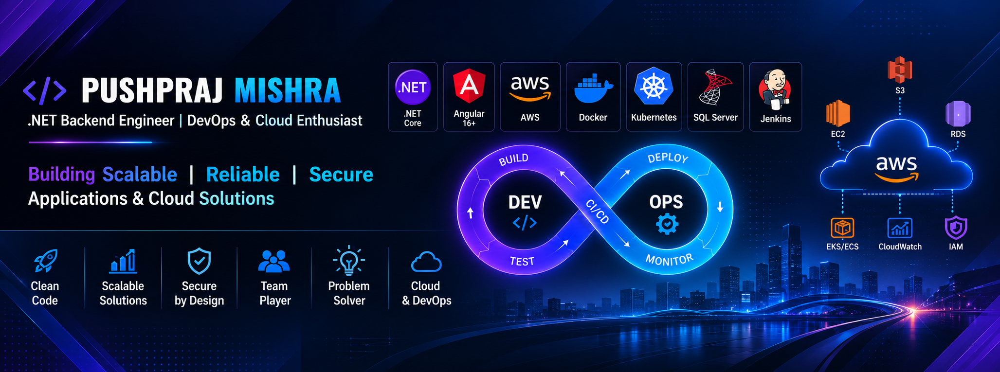

**Senior .NET Backend Engineer** · Mumbai, India · **6.6+ years** in software engineering

---

## About Me

I build backend applications, APIs, integrations, and data-processing services with **C#, .NET, SQL, and Entity Framework**. My experience spans microservices, messaging systems, AWS deployments, and enterprise products in sustainability, social media analytics, and employee services.

I care about maintainable architecture, dependable services, performance, and observability. I enjoy turning manual workflows into reliable automated systems and solving production problems with measurable impact.

## Technology Stack

<table>
<tr><td><b>Backend</b></td><td>C# · .NET / .NET Core · ASP.NET Core Web API · MVC · ADO.NET · EF / EF Core · OOP · Clean Architecture</td></tr>
<tr><td><b>Data</b></td><td>SQL Server · PostgreSQL · Redis · Elasticsearch</td></tr>
<tr><td><b>Messaging</b></td><td>Apache Kafka · Amazon SQS · SNS · MSMQ</td></tr>
<tr><td><b>AWS</b></td><td>EC2 · S3 · RDS · VPC · IAM · Lambda · EventBridge · ECR · ECS · EKS · Route 53 · ELB · Auto Scaling · CloudWatch · CloudTrail</td></tr>
<tr><td><b>DevOps</b></td><td>Docker · Kubernetes · Jenkins · GitHub Actions · Prometheus · Grafana · Linux</td></tr>
<tr><td><b>Frontend</b></td><td>JavaScript · Angular 16+ · HTML · CSS · Bootstrap · jQuery · Highcharts</td></tr>
<tr><td><b>Quality & Tools</b></td><td>NUnit · xUnit · Moq · Postman · Serilog · Visual Studio · VS Code · Git · GitLab · Bitbucket · Azure Repos</td></tr>
</table>

## Impact at a Glance

<table>
<tr>
<td align="center" width="25%"><h2>$120K</h2>Annual operational cost reduction from a data ingestion worker service</td>
<td align="center" width="25%"><h2>30%</h2>Higher data collection efficiency</td>
<td align="center" width="25%"><h2>50+</h2>Critical bugs resolved on LocoBuzz Response Dashboard</td>
<td align="center" width="25%"><h2>240K+</h2>Employees supported by Shared Services Center processes</td>
</tr>
</table>

## Featured Projects

<b>Data Ingestion Worker Service — CI, PA & PS</b> · .NET Worker Service · AWS · Parallel processing

- Automated a previously manual vendor-data retrieval workflow and ingestion into internal APIs.
- Used the Factory design pattern and parallel batch processing for high-volume data.
- Deployed on AWS EC2 and added structured logging with Serilog.
- **Reported impact:** $120K reduction in annual operational costs.

<b>Issuer Feedback Management (IFM)</b> · Clean Architecture · EF Core · PostgreSQL

- Built a feedback portal to help issuers resolve data mismatches before rating release.
- Developed backend APIs and Code-First database migrations using EF Core.
- Applied the Repository pattern and integrated Serilog for troubleshooting and observability.

<b>Inrate — Inside & Clif</b> · Sustainability · Investment impact

- Developed and enhanced modules for Peer Benchmarking, EU Taxonomy, IFM, SFDR, and UNGC.
- Worked on backend APIs and data access using C#, SQL, ADO.NET, EF, and EF Core.

<b>Social Media Data Collection</b> · Microservices · Kafka · SQS · S3 · Elasticsearch

- Built services to collect data from multiple social media platforms.
- Researched third-party APIs and implemented collection workflows with .NET Core and AWS.
- **Reported impact:** 30% improvement in data collection efficiency.

<b>Shared Services Center — L&T Group</b> · .NET Core Web API · SQL · SharePoint

- Contributed to a portal for payroll, health, and retirement benefits.
- Worked on revamping services supporting processes for **240,000+ employees**.

<b>LocoBuzz Response Dashboard</b> · .NET MVC · C# · SQL · Highcharts

- Contributed to social media analytics, CRM, trend monitoring, and campaign reporting.
- **Reported impact:** 15% better system responsiveness, 50+ critical bugs resolved, and 20% lower downtime.

<b>Cx Suite</b> · .NET Core · Web API · SQL

- Developed features for a social media analytics and engagement platform.
- **Reported impact:** 25% faster UI, 30+ bugs corrected, and a reported 15% improvement in application stability.

<b>TATA Neu Command Center & NBA Score Screen</b> · .NET MVC · Highcharts

- Built monitoring features and visualizations for command-center screens.
- **Reported impact:** 20% improvement in decision-making efficiency.

## Professional Experience

| Organization | Period | Focus |
|---|---|---|
| **SG Analytics** | Oct 2024 – Present | Sustainability and investment-impact platforms; backend modules and APIs |
| **LTIMindtree** | Jun 2023 – Oct 2024 | Enterprise applications; .NET Core Web API, SQL, SharePoint, Azure DevOps |
| **LocoBuzz Solutions** | Sep 2018 – Jul 2020; Aug 2021 – Jun 2023 | Social media analytics, backend APIs, data collection microservices |

*Career break: July 2020 – August 2021 for competitive examination preparation.*

## Recognition

- **GEM Award — SG Analytics**, for exceptional performance during the first quarter after joining.
- **Scrum Rockstar** (twice) and **Acting Scrum Master** (twice) — LocoBuzz.
- **Problem Solver Badge**, **Hi-Fi Badge**, and **Project Rockstar** — LTIMindtree.
- Contributed to deployment of LocoBuzz 2.0 web application and services in Reliance Jio infrastructure.

## Education

- **B.Sc. Information Technology** — V.E.S. College of Arts, Science and Commerce (2015–2018), 78.48%
- **HSC** — National Sarvodaya Junior College (2013–2015), 72.77%
- **SSC** — Chembur Karnataka High School (2013), 75.64%

## Currently Exploring

AWS architecture · Docker and Kubernetes · CI/CD automation · Observability with Prometheus and Grafana · Microservices resilience and production troubleshooting

## Connect

- **LinkedIn:** [linkedin.com/in/ipushprajmishra](https://www.linkedin.com/in/ipushprajmishra)
- **Email:** [ipushprajmishra@gmail.com](mailto:ipushprajmishra@gmail.com)
- **GitHub:** [github.com/ipushprajmishra](https://github.com/ipushprajmishra)

Thanks for visiting my profile.

